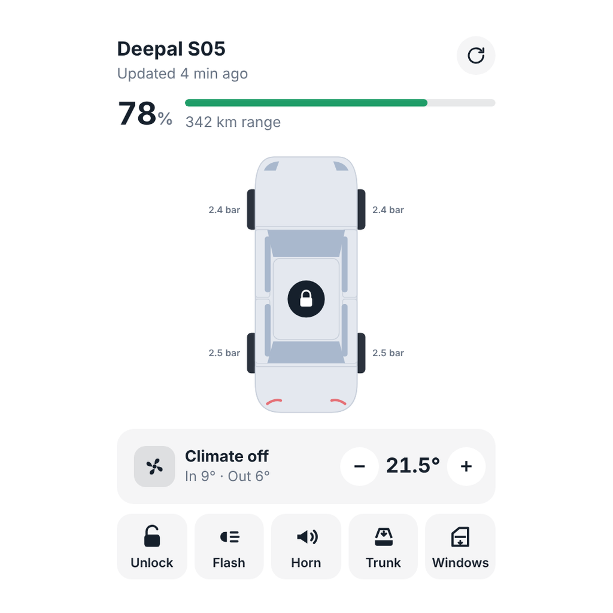

# Deepal for Homey (unofficial)

A Homey Pro app for **Deepal / Changan** connected cars. It shows battery, range, charging and
tire pressures, and lets you lock the car, start the climate, heat the seats and steering wheel,
and more, from Homey, Flows and a dashboard widget.

It is built and tested on a **Deepal S05** in Norway (EU region). It is a Node.js port of the
protocol work in [ha-deepal-alternative](https://github.com/Sunek0/ha-deepal-alternative) by
Sunek0 and contributors (MIT), made for Home Assistant. See [Credits](#credits).

## Important warnings

- **Use it at your own risk.** This is an unofficial app. It is not made, endorsed or supported by
  Changan or Deepal. It uses Changan's private cloud API in a way they never intended, and they can
  change or block it at any time. In the worst case, **Changan can sign out, suspend or ban the
  account** you use with it. Nobody here can help you get it back.
- **Remote commands act on the real car.** Check that it is safe before you lock, open windows or
  the trunk, start the climate, flash the lights or sound the horn, especially from a Flow.
- **It cannot drive the car.** It has no digital key or Bluetooth support.
- **Create a dedicated Changan account for Homey.** Whichever account you log in with on Homey is
  signed out of the My Changan app, and the other way round. So do not use your main account:
  create a second account and share the car with it (see [Before you start](#before-you-start)).
- **Set the remote-control PIN in the My Changan app first.** Do this on the account you will use
  with Homey, *before* you log in to Homey. Lock, unlock, windows and trunk need it.
- **The S05 is only woken now and then.** Normal polls never wake the car. A wake (the *Wake the
  car and refresh* Flow card, or automatically before a PIN command) is limited to once every
  5 minutes, to protect the 12 V battery.

## What it does

### Device

Add the car as a device and it gets these:

| Area | Details |
| --- | --- |
| Battery and charging | Battery %, range, charging state, charge current, charge time remaining. |
| Car | Locked, odometer, doors/hood open, trunk open, windows open. |
| Climate | Climate on/off, target temperature (16–32 °C), cabin temperature, outside temperature, cabin humidity. |
| Comfort | Driver and passenger seat heating (off, level 1–3), steering wheel heating on/off. |
| Tires | Pressure for each wheel and a tire pressure warning. |
| Warning lights (S05) | 12 V battery, ABS, brake, brake fluid, power steering, power limit, power system, traction battery low, key fob battery. Each one appears the first time the car reports it, and is only read while the car is on. |
| Other | Time of the last report. The car is registered as an electric car for Homey Energy. |

The device settings let you set the poll interval, the climate run time, the remote-control PIN, and
whether the car may be woken before PIN commands.

### Flow cards

**When** (triggers)

- Charging started
- Charging stopped
- A dashboard warning light turned on (gives the light's name as a tag)
- Homey's built-in cards for each capability, such as battery level changed, locked changed, or a
  door opened

**And** (conditions)

- Is / is not charging
- Is / is not plugged in

**Then** (actions)

- Start climate at a chosen temperature
- Stop climate
- Set seat heating (driver, passenger or both, off or level 1–3)
- Turn steering wheel heating on or off
- Flash the lights
- Sound the horn
- Flash the lights and sound the horn
- Open the trunk (needs the PIN)
- Open or close the windows (needs the PIN)
- Set charge limit (not supported by the S05, which accepts it without effect)
- Wake the car and refresh

### Dashboard widget

*Deepal car* shows a top view of the car and lets you control it from a Homey dashboard.

- Doors, windows, trunk, hood, tire pressures, the charging cable and the climate state are drawn
  on the car. The cabin glows blue when cooling and orange when heating.
- Tap the lock badge on the roof to lock or unlock, the front to flash the lights, and the tailgate
  to open the trunk. Unlocking, the trunk and the windows ask for a second tap.
- Climate on/off with temperature − and +, driver and passenger seat heating, steering wheel
  heating, and buttons for lock, flash, horn, trunk and windows.
- A refresh button wakes the car and reads fresh data.
- It updates live, and each command shows a short result message.
- With more than one car, tap the name to switch.



### Languages

English and Norwegian (Bokmål). Homey's language setting decides which one you see.

## Before you start

You need:

- A **Homey Pro** (2023 or later) with firmware 12.4.5 or newer. Homey Cloud and the Homey Bridge
  cannot run this app.
- **Node.js 20 or newer** and `git` on your computer.
- A Deepal / Changan car that works in the My Changan app.
- A **second Changan account** just for Homey.

Prepare the account (do this once, in the My Changan app):

1. Register the second account in the My Changan app. It must be registered there first, or the
   login fails with `CAC_1_1_01_024 Account not registered`. Use the same sales country as your car.
2. Share the car from your main account with the second account, and accept the share.
3. Log in to the My Changan app with the second account and **set the 6-digit remote-control
   PIN**. Remember it, because you will enter it in Homey.
4. Log back in with your main account in the app. From now on, Homey uses the second account.

## How to install on Homey

1. **Install the Homey CLI.**

   ```sh
   npm install -g homey
   homey login
   ```

   Log in with your Athom account when the browser opens.

2. **Get the app.**

   ```sh
   git clone https://github.com/hrkvalvik/homey-deepal.git
   cd homey-deepal
   ```

3. **Put it on your Homey.** Run this from your computer's normal terminal while on the same
   network as the Homey, and select your Homey when asked.

   ```sh
   homey app install
   ```

   This keeps the app installed. To try it with live logs instead, run `homey app run` (it stops
   when you press Ctrl+C).

   To update later, pull the new version and run `homey app install` again. It updates in place and
   keeps your car, PIN and Flows. **Do not uninstall the app to update it:** that deletes them.

4. **Add the car.** In the Homey app, go to *Devices → + → Deepal → Deepal vehicle*.
   1. Choose **Email code** (recommended) or SMS code.
   2. Enter the email of the second account, your **sales country** as a 2-letter code (for example
      `NO`), and the region (**Europe** for EU cars).
   3. Press *Send verification code*, then type the code you receive and press *Log in*.
   4. Pick your car from the list and add it.

5. **Enter the PIN.** Open the new device, go to its settings and fill in *Remote-control PIN*. It
   is checked against the account when you save it. Without it, lock, windows and trunk do not
   work.

6. **Try it.** The first reading can take a minute. Check *Last report*, then flash the lights.
   If the report looks old, use the *Wake the car and refresh* Flow card.

7. **Add the widget (optional).** Open a dashboard, press *Edit*, then *+ → Deepal → Deepal car*.

## Troubleshooting

| Problem | What to do |
| --- | --- |
| `Account not registered` when logging in | Register the account in the My Changan app first, and use the same sales country as the car. |
| The device says the session expired | Another login signed Homey out (often the My Changan app on the same account). Open the device and choose *Repair* to log in again. Use a dedicated account to avoid this. |
| Lock, windows or trunk say a PIN is needed | Set the 6-digit PIN in the device settings, after setting it in the My Changan app. |
| The car does not answer a command | The car may be asleep. Wait a few minutes (wakes are limited to once per 5 minutes) and try again. |
| `homey app install` fails with a `400`, or `EHOSTUNREACH` appears (macOS) | macOS may be blocking Node.js from the local network. Run the command from the built-in Terminal app, and check that Terminal is allowed under *System Settings → Privacy & Security → Local Network*. |
| The widget is very small or empty | Remove it from the dashboard and add it again. Homey caches the widget height. |

## Status

Everything is built for and tested with a Deepal S05 in Norway.

| Part | Status |
| --- | --- |
| Email code login, token refresh | Works on a real S05. |
| S05 live data over MQTT, wake | Works on a real S05. |
| Climate, lock, windows, trunk, lights, horn | Works on a real S05. |
| Seat and steering wheel heating | New in 0.2.0, ported from the upstream S05 support. Less tested than the rest. |
| Other models (S07, E07) | Read through the REST snapshot. Not tested here. |
| E07 live data over `SDA-MQTT` | Not implemented. |
| Latin America region | Selectable at login, not tested. |
| Charge schedule, location, seat ventilation | Not exposed. |

Please report problems as issues. Do not paste tokens, PINs or verification codes in them.

## Development

```sh
npm test                               # offline tests, with a fake gateway and a fake MQTT broker
homey app validate --level publish
```

There are no npm dependencies. Everything uses Node's built-in `crypto`, `tls` and `fetch`.

```
app.js                  The shared account session, Flow card registration, widget API entry points
lib/DeepalClient.js     REST: login, token refresh, vehicles, condition, signed commands, MQTT bootstrap
lib/mqtt.js             Minimal MQTT 5 client and the S05 login/condition/wake exchange
lib/crypto.js           Request encryption, login keypair, command signing, serial decryption, AES-CBC
lib/condition.js        Condition parsing and S05 parameter normalization
drivers/vehicle/        Pairing, device (polling, commands), settings, Flow cards
widgets/car/            Dashboard widget
.homeycompose/          App manifest and custom capabilities (the root app.json is generated)
test/                   Offline tests (node --test)
locales/                Translations (en, no)
```

Edit `.homeycompose/`, not the generated `app.json`. The `ha-deepal-alternative` repo's
`deepal_sdk/docs/reference/` has the protocol reference.

## Credits

- The protocol, crypto, login flow, S05 MQTT exchange and command signing come from
  [ha-deepal-alternative](https://github.com/Sunek0/ha-deepal-alternative) by Sunek0 and its
  contributors (MIT), which this app ports to Node.js. The license text is in [LICENSE](LICENSE).

## License and trademarks

MIT, see [LICENSE](LICENSE). Deepal and Changan are trademarks of their owners. This project is not
affiliated with them. The app and device images are photos taken by the author. The Deepal emblem
used as the app icon belongs to its owner.
